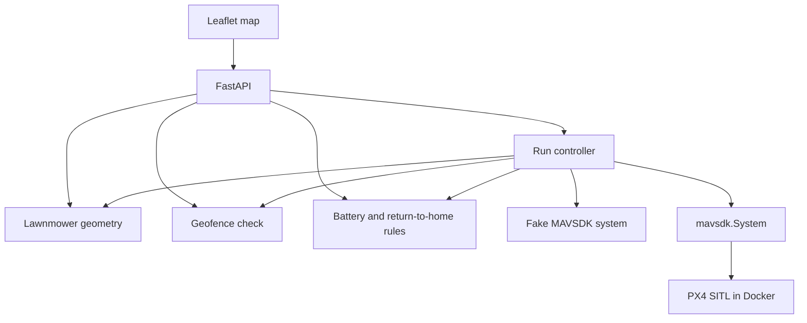

# PX4 survey mission planner

A survey-grid mission planner for PX4. Draw a polygon, generate a lawnmower path, check it against the geofence and a return-to-home energy rule, then upload it through a vehicle that speaks the MAVSDK `System` interface.

The default process uses an in-memory fake of that interface, so the map works with no radio, no API key, and no simulator. A second entry point connects to PX4 SITL with the real MAVSDK client. This repository is a portfolio demo by Arpan Bom. It has not been flight-tested.

## Architecture



The browser only talks to FastAPI. Planning is pure Python. The controller is the only piece that calls a vehicle, and it calls the same plugins MAVSDK exposes: `core`, `telemetry`, `mission`, `action`, and `geofence`. Tests pass a `FakeSystem`. SITL passes a real `mavsdk.System` through `MavsdkWire`, which builds `MissionPlan` and `GeofenceData`.

On a launch that is allowed to fly, the controller does this in order:

1. Connect and wait until the vehicle is connected and armable.
2. Read the vehicle home and plan the survey from that home.
3. Read the battery. MAVSDK reports remaining charge as a fraction from 0 to 1.
4. Refuse, without arming, if the home or the path fails the geofence, or if the energy rule says no.
5. Set return-to-launch after the mission. MAVSDK applies that flag on the next upload.
6. Upload the inclusion geofence, upload the mission, arm, and start.

`enforce_rth_reserve` is the in-flight half of the battery rule. It reads one sample and calls `return_to_launch` when the remaining percentage is at or below the landing reserve. The map exposes that as "Check return reserve". It does not loop on telemetry.

## Run the map

```bash
python -m venv .venv
source .venv/bin/activate
pip install -e ".[dev]"
python -m mission_planner
```

Open [http://127.0.0.1:8091](http://127.0.0.1:8091).

Click **Sample field**, then **Preview path**. The sample is an 80 m square around the historical PX4 Gazebo iris home at Zurich Irchel (47.397742, 8.545594). **Arm and start** records the mission on the fake vehicle. Nothing is transmitted.

`PORT` and `HOST` override the bind address. The default port is 8091.

## Run against PX4 SITL

This is a local Docker step. CI does not start PX4, and this demo was not executed against a simulator.

The image below is the unofficial headless SITL image, pinned to `1.17.0`. It is large. On Linux, `--network host` plus the `127.0.0.1` argument are required: without the address, the image sends MAVLink to the container's default gateway instead of the host. PX4's offboard stream then arrives on UDP 14540.

```bash
docker run --rm -it --network host jonasvautherin/px4-gazebo-headless:1.17.0 127.0.0.1
```

In another shell, from this repo:

```bash
source .venv/bin/activate
pip install -e ".[sitl]"
python -m mission_planner.sitl
```

`mission_planner.sitl` listens on `udpin://0.0.0.0:14540` unless `PLANNER_SYSTEM_ADDRESS` is set. Open the map, load the sample field, preview, and arm. The sample square is centered on the historical iris start so that a default SITL home falls inside the fence. A world file can move the simulator. If launch reports that home is outside the geofence, redraw the polygon around the vehicle.

The SITL extra installs `mavsdk`. Unit tests do not import it.

## Energy model

The go / no-go rule is real. The two rates it multiplies are not. They are placeholders so the rule can be tested and shown on the map. They are not measurements, flight logs, or manufacturer data. Replace `capacity_wh` and `wh_per_km` in `mission_planner/energy.py` with the airframe's own figures before pointing this at a real vehicle.

| Input | Placeholder or setting |
| --- | --- |
| Pack capacity | 100 Wh, placeholder |
| Cruise draw | 20 Wh/km, placeholder |
| Minimum to start | 30% |
| Landing reserve | 20% of the pack, held back |
| Return factor | 1.2 times the distance from home to the farthest waypoint |

Launch is allowed only when the remaining percentage is at least the start minimum and the available watt-hours cover the survey, a return from the farthest waypoint, and the landing reserve. The survey distance includes the legs between transects and the departure from home. It does not include the return, and it does not give credit for the part of the survey you might skip if you abort early. The farthest waypoint is that abort case.

The "time at the set speed" figure is path length divided by the speed you typed. It is not a timed flight.

The waypoint acceptance radius defaults to 3 m. That value is sent to PX4 as an acceptance radius. It is not a measured position accuracy.

## Test

```bash
pytest
```

That runs the geometry, geofence, mission, controller, and API tests. The controller tests use `FakeSystem`. No SITL, no Docker, no browser.

GitHub Actions (`.github/workflows/ci.yml`) runs the same `pytest` command on Ubuntu with Python 3.12. The workflow does not install MAVSDK and does not start a simulator.

## License

MIT, see [LICENSE](LICENSE). The map uses [Leaflet](https://leafletjs.com) 1.9.4, BSD 2-Clause, under `web/vendor/`. Basemap tiles are CARTO's dark tiles, which include OpenStreetMap data.
